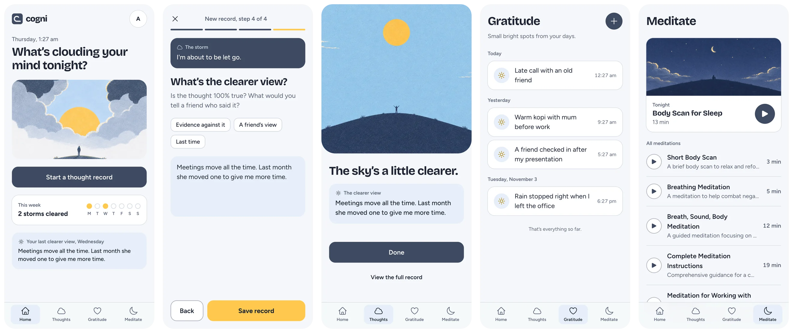
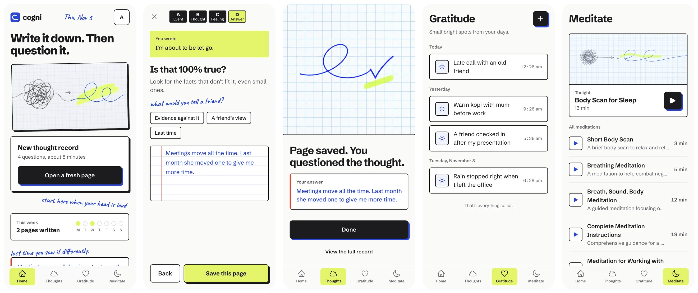
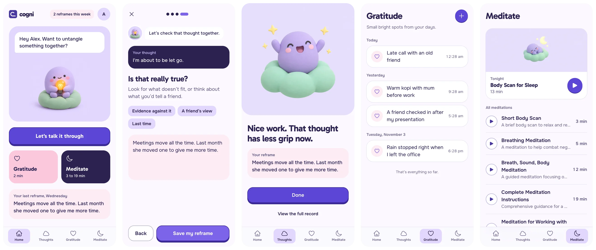

# Cogni

A small, calm app for the moments when a worrying thought won't let go.

Cogni walks you through a **thought record**, a simple exercise from cognitive behavioural therapy (CBT). You write down what happened, the thought that showed up, and how it made you feel. Then you ask yourself if the thought is really true, and write a fairer way to see it. Most anxious thoughts look smaller once they're on the page.

Alongside that, Cogni keeps a short **gratitude** list and has **guided meditations** for when you just need to breathe.

Try it at [cogni-app.com](https://cogni-app.com). It's free and installs like an app on your phone or computer.

> Cogni is a self-help tool, not a replacement for a therapist. If you're struggling, please reach out to a professional or a local helpline.

## What you can do

- **Untangle a hard thought** in 4 short steps: what happened, the thought, the feeling, and a clearer view
- **Write down small good things** from your day, so they're easy to look back on
- **Take a breather** with 8 guided meditations, from 3 to 19 minutes
- **Pick a look that suits you**: Clearing, Workbook or Companion, each in light and dark mode
- **Keep it to yourself**: only you can read your entries

## Three styles

Same app, three moods. Switch any time from your account menu.

### Clearing

Storm clouds part as you work through the thought. Calm and quiet.

### Workbook

Pen, graph paper and a highlighter. For people who like to think on paper.

### Companion

Cog, a friendly little character, keeps you company while you write.

_All screenshots use made-up example entries._

## Install it as an app

1. Open [cogni-app.com](https://cogni-app.com) in your browser
2. Install it:
    - **Phone:** use "Add to Home Screen" from the browser menu
    - **Desktop:** click the install icon in the address bar
3. Open Cogni from your home screen. It opens even when you're offline, though your entries need a connection to load and save.

## For developers

### Built with

- **App:** [Nuxt 3](https://nuxt.com/), TypeScript, [Pinia](https://pinia.vuejs.org/), TailwindCSS
- **Sign-in and data:** Firebase Auth and Firestore
- **Hosting:** Cloudflare Pages, with a preview link for every PR
- **Encryption:** entries are encrypted with AES-GCM before saving

### Security rules

`firestore.rules` makes sure people can only read their own entries. Deploy with `npx firebase-tools deploy --only firestore:rules`. This overwrites the rules in the Firebase console.
