# Cogni - CBT Web Application

A Progressive Web Application (PWA) built with Nuxt 3, implementing Cognitive Behavioral Therapy (CBT) techniques to assist users in managing thoughts and emotions. The application provides structured tools for mental wellness practice, with each user's entries kept private by Firestore security rules.

Live at [cogni-app.com](https://cogni-app.com).

## Features

- **Thought records** - Untangle a hard thought in 4 short steps: what happened, the thought, the feeling, and a clearer view
- **Gratitude** - Keep a list of small good things from each day
- **Guided meditation** - 8 tracks from 3 to 19 minutes
- **Three styles** - Clearing, Workbook and Companion, each in light and dark mode
- **Installable** - Works as an app on phone and desktop, and opens offline
- **Private Entries** - Firestore security rules let users read and write only their own entries

## Screenshots

All screenshots use made-up example entries.

### Clearing

| Home | Thought record | Saved | Gratitude | Meditate |
| --- | --- | --- | --- | --- |
| 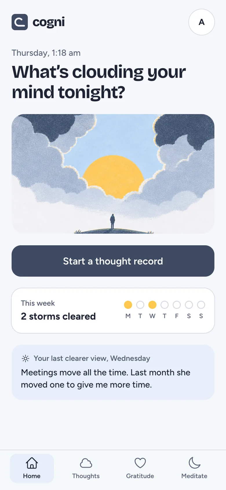 | 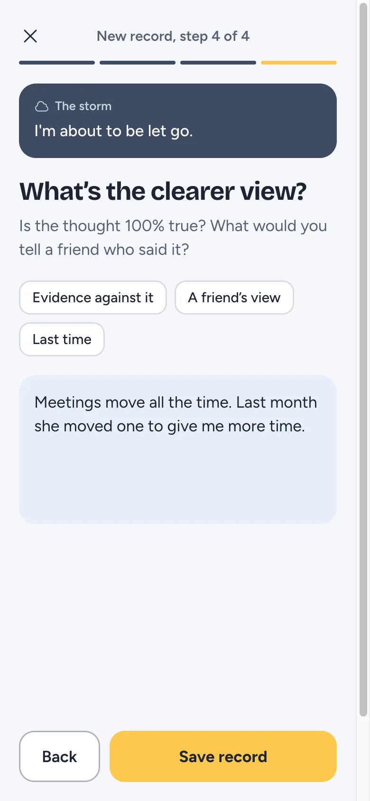 | 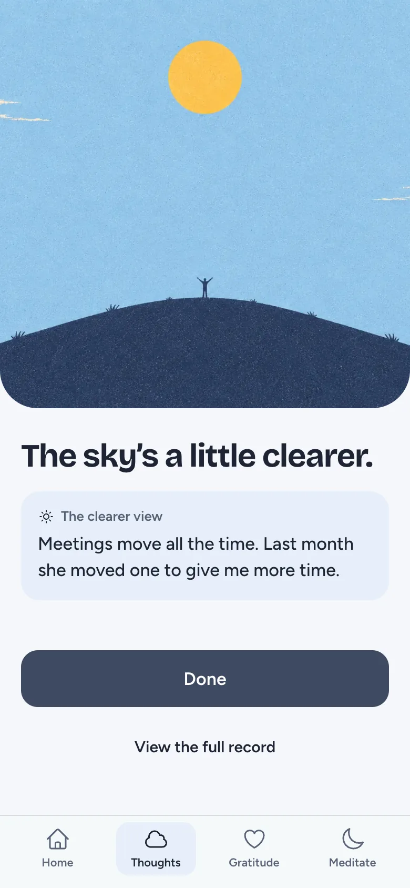 | 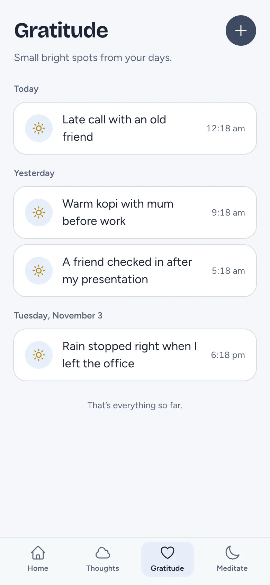 | 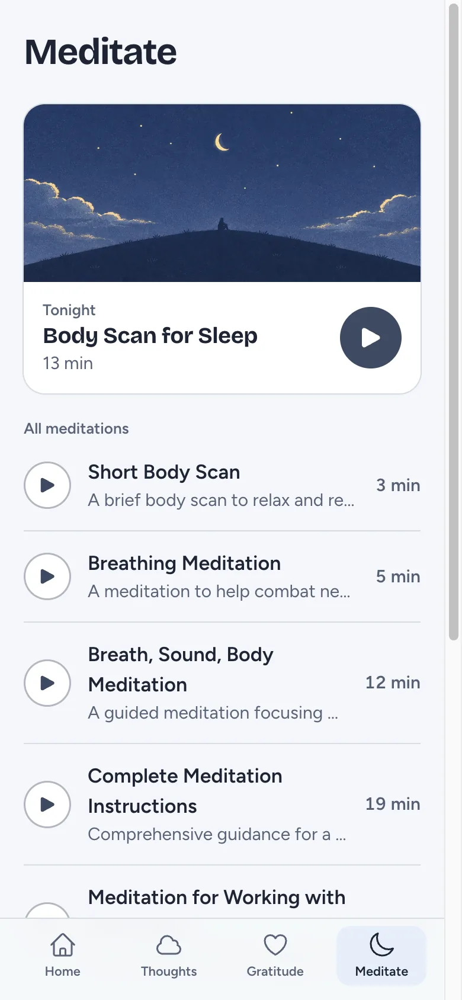 |

### Workbook

| Home | Thought record | Saved | Gratitude | Meditate |
| --- | --- | --- | --- | --- |
| 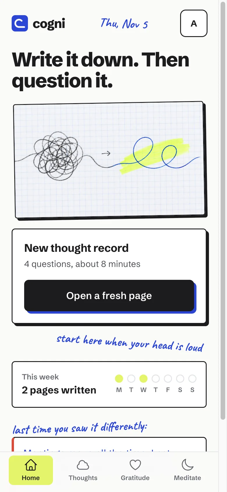 | 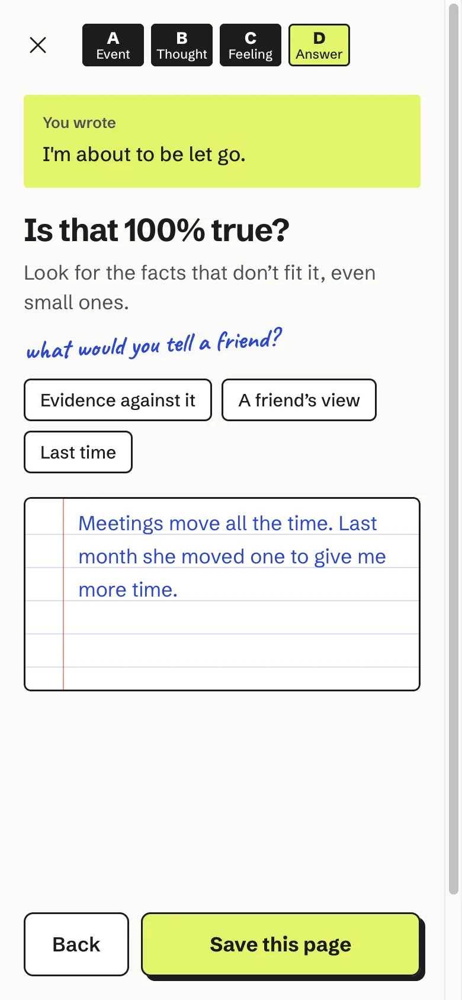 | 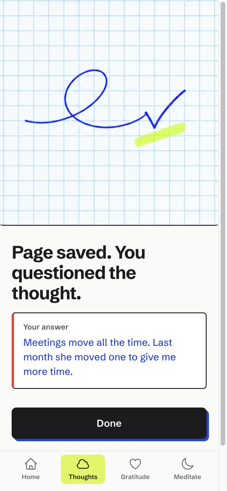 | 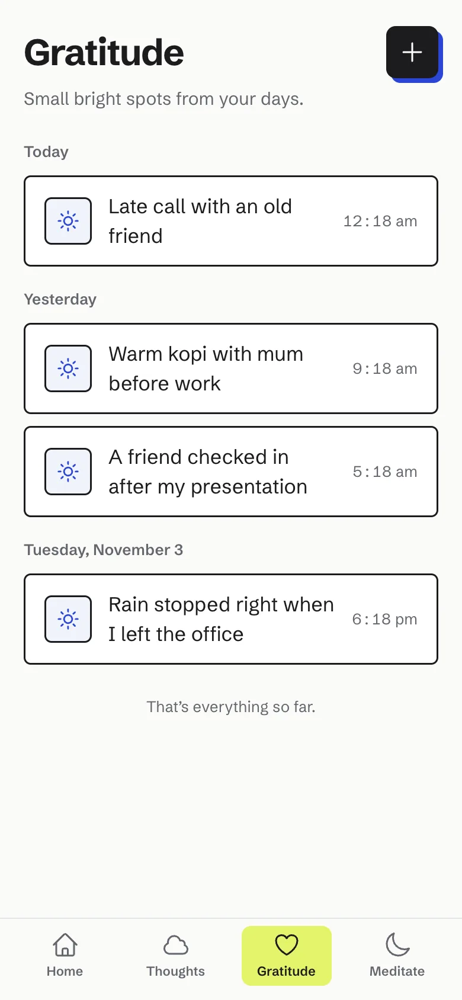 | 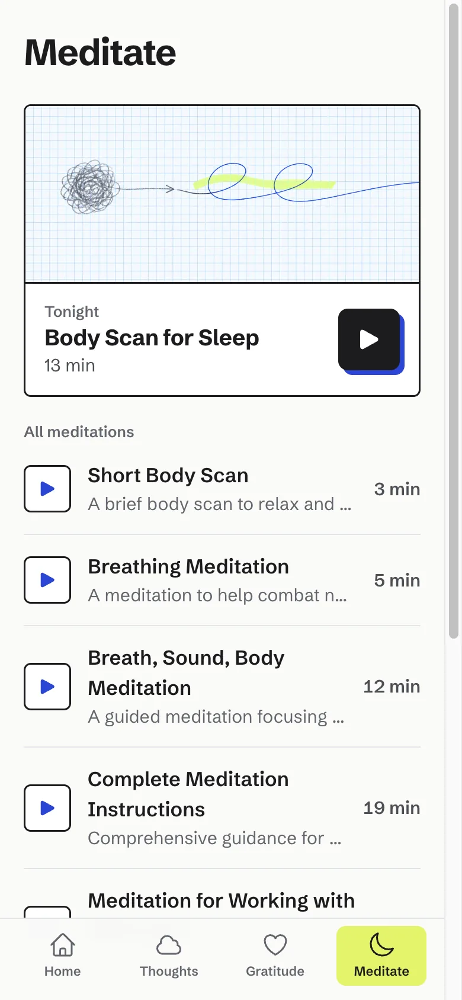 |

### Companion

| Home | Thought record | Saved | Gratitude | Meditate |
| --- | --- | --- | --- | --- |
| 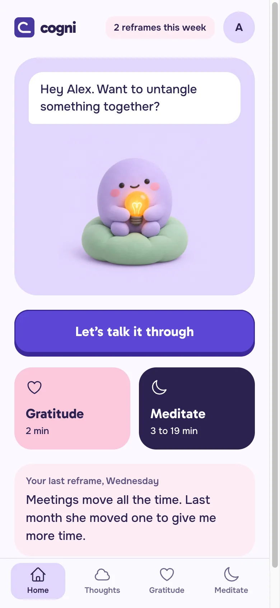 | 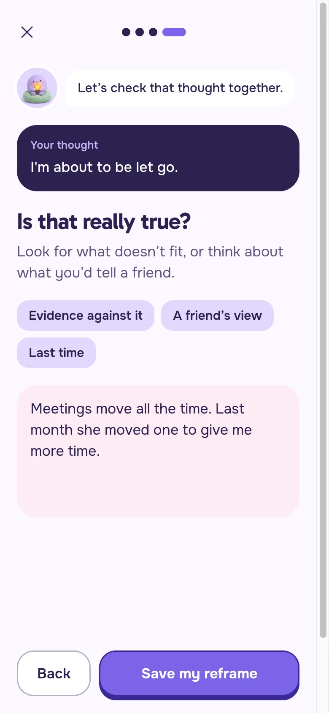 | 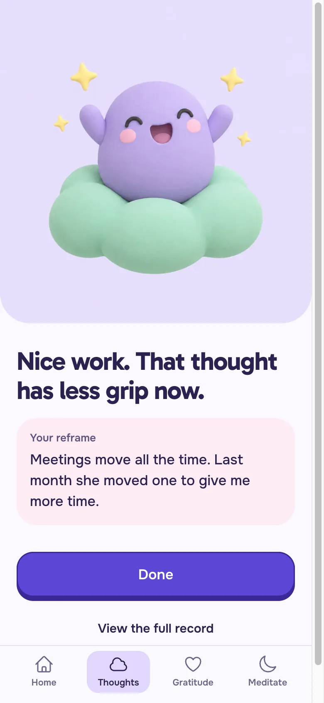 | 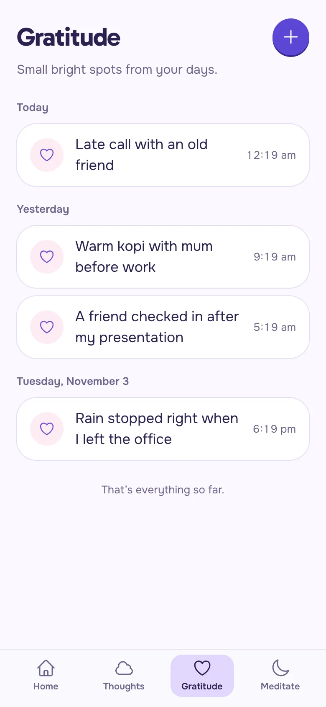 | 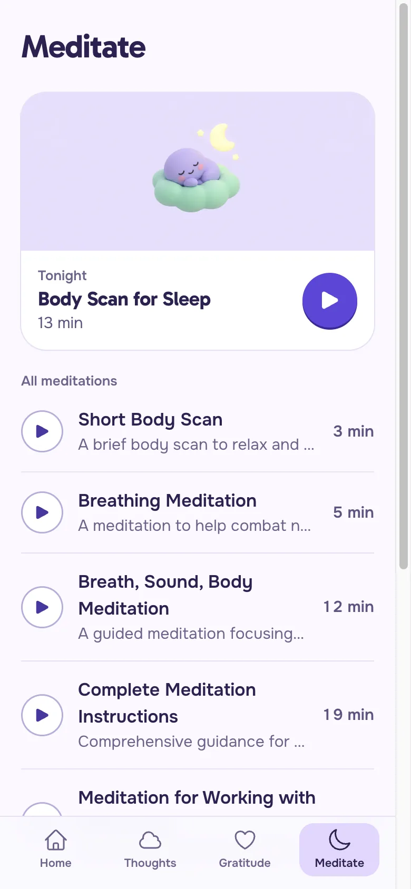 |

## Technology Stack

- **Framework:** [Nuxt 3](https://nuxt.com/)
- **Language:** TypeScript
- **State Management:** [Pinia](https://pinia.vuejs.org/)
- **Hosting & Deployment:** Cloudflare Pages (builds from GitHub; every PR gets a preview link)
- **Authentication & Database:** Firebase (Auth & Firestore)
- **Encryption:** Web Crypto API (AES-GCM with a shared app key; this obscures entries at rest but is not end-to-end encryption, since the key ships in the client bundle)
- **UI Framework:** TailwindCSS

## Firestore Security Rules

Rules live in `firestore.rules` and are deployed with:

```bash
npx firebase-tools deploy --only firestore:rules
```

Deploying replaces the rules currently set in the Firebase console.

## PWA Installation

The application can be installed as a Progressive Web App on supported devices:

1.  Access the application through a compatible web browser
2.  Use the browser's install functionality:
    - Desktop: Look for the install icon in the address bar
    - Mobile: Use the browser's "Add to Home Screen" option
3.  Follow the installation prompts
4.  Access the application from your device's home screen
